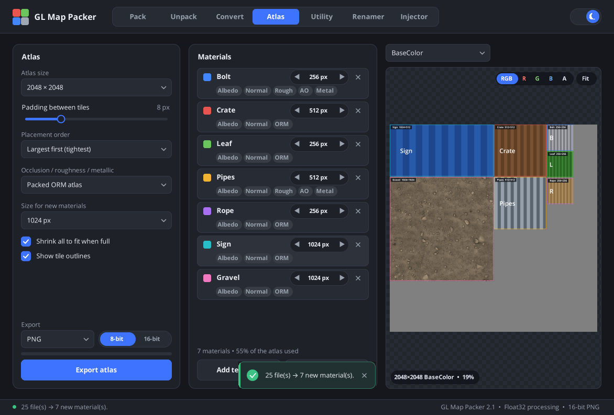

# GL Map Packer tutorial

This guide walks through every tab. Each section is short: load something, change a few settings, save.

- [The basics](#the-basics)
- [Pack: build a channel-packed texture](#pack)
- [Unpack: split a texture into channels](#unpack)
- [Convert: normal, height and AO maps](#convert)
- [Atlas: pack materials into one texture atlas](#atlas)
- [Utility: flip and invert](#utility)
- [Renamer: batch-rename texture files](#renamer)
- [Injector: send a material to Maya](#injector)
- [Tips and shortcuts](#tips-and-shortcuts)

---

## The basics

Tabs run across the top. The sun/moon switch on the right changes between dark and light themes.

Every preview works the same way:

| Action | How |
|---|---|
| Load a file | Drag it onto the preview, or use the **Load** button |
| Zoom | Mouse wheel (zooms toward the cursor) |
| Pan | Drag while zoomed in |
| Back to full view | Double-click, or press **Fit** |
| Look at one channel | Click **R**, **G**, **B** or **A** in the top-right pill (**RGB** goes back) |
| Compare before and after | Drag the white divider (on Convert and Utility) |

The bottom-left corner of a preview shows the image size and zoom level. Messages such as "Saved…" or errors appear briefly at the bottom of the window and stay in the status bar.

---

## Pack

Combine separate grayscale maps into one texture, for example an Unreal **ORM** map (R = AO, G = Roughness, B = Metallic).


1. **Fill the channel slots.** Drop an image onto the **Channel R / G / B / A** cards, or double-click a card to browse.
2. **Choose what each slot uses.** The dropdown under each slot picks the source channel of that image (**Use red / green / blue / alpha**). Pick **Constant white** or **Constant black** to fill a channel without an image.
3. Press **Pack now**. The result appears in the large preview. Use the **R/G/B/A** pill to check each channel landed where you expect.
4. Choose a **Format** (PNG, TGA, TIFF, BMP or JPEG) and press **Save packed map**.

> **Tips**
> - Use images of the same size; the output takes the size of the first filled slot (checked in R, G, B, A order).
> - A slot left empty becomes black, except **A**, which becomes white (fully opaque).
> - The **×** on a slot clears it.
> - The **Preset** list is a reminder of common layouts. It doesn't fill the slots yet.

---

## Unpack

Split a packed texture into its four channels, each saved as its own grayscale image.


1. Drop a texture onto **Source texture**, or press **Load texture**. The four channel cards fill in straight away.
2. Each card has a **suffix** box (`_R`, `_G`, `_B`, `_A` by default). Change it to something meaningful, such as `_AO`, `_Roughness` or `_Metallic`.
3. Save in one of two ways:
   - the **↓** button on a card saves just that channel, or
   - **Save all channels** saves all four.

   Tick **Save next to the source (no dialog)** to write them straight into the source file's folder as `<name><suffix>.png`.

---

## Convert

Turn one kind of map into another. The preview shows the **Source** on the left and the **Result** on the right; drag the divider to compare. The preview updates as you move the sliders. It renders a 512 px copy for speed, and **Save result** renders the full-size file.

At the bottom of the tab:

- **Output resolution:** keep the source size, or resample to 512, 1024, 2048 or 4096 px (longest side).
- **PNG bit depth:** starts at the bit depth of the file you loaded (a 16-bit PNG gives 16-bit, anything else 8-bit). Click the other side to change it for this file.
- **Load map** and **Save result.** The save dialog suggests `<name>_height.png`, `_normal.png` or `_ao.png`.

When you load a file, the mode is picked from its name: a file whose name contains `normal` or ends in `_n`, `_nrm` or `_nor` starts in **Normal → Height**, and anything else starts in **Height → Normal**.

### Normal → Height

Rebuilds a height map from a normal map's slopes, keeping both the fine detail and the broad shapes.


| Setting | What it does |
|---|---|
| **Height intensity** | How far the surface rises and sinks from the baseline. |
| **Mid-point baseline** | The gray level of the flat surface (0.5 = middle gray). Raise it if the map is mostly dents, lower it if it's mostly bumps. |
| **Contrast** | Pushes heights toward the extremes (+) or flattens them (−), around the baseline. |
| **Surface blur** | Smooths small imperfections in the normal map before they become height noise (in output pixels). |
| **Flatten broad** | Turns down the large, gentle shapes. 0% keeps them; 100% gives a detail-only height map. |
| **Detail boost** | Turns up the fine detail. Broad shapes take most of the gray range, which can make detail look soft next to them; 1.5 to 2.5× brings back the crispness without losing the shapes. |
| **Normal map format** | **OpenGL (Y+)** for Blender, Maya, Substance and most tools. **DirectX (Y−)** for Unreal and 3ds Max. If the result looks inverted, like hills where there should be holes, switch this. |
| **Integration** | How the texture is joined up. See below. |

#### Integration: tileable, UV islands or mesh-aware

A normal map baked onto a model stores slopes **relative to each UV island's orientation**. If the converter treats the whole texture as one flat surface, islands affect each other through the gutters, and broad slopes on islands that are rotated in UV point in different directions on the model. The result is height that **steps at the seams**. Pick the integration that fits your texture:

| Integration | Use it for | What you add |
|---|---|---|
| **Tileable** | Tiling materials and anything without UV islands. The whole image is one continuous surface. | Nothing |
| **UV islands (mask)** | Baked maps when you want each island's broad shape kept. Each island is solved on its own and centred on the baseline, so heights at a seam can still differ. | A **UV mask**: islands filled white on black, or an **ID map** where each island has its own color |
| **Mesh-aware (3D)** | Baked maps where heights must **meet across seams**, for example displacement. The model tells the converter which island edges are the same edge on the mesh and how big each texel is on the surface, so the whole model is solved as one continuous surface. | The **low-poly model** as `.obj` with UVs |


**Using mesh-aware mode:**

1. Choose **Integration → Mesh-aware (3D)**. A **3D model** box appears below.
2. Drop the low-poly model onto it, or click it to browse. Use the same mesh and UV set the normal map was baked on, exported as **OBJ with UVs**. Triangles, quads and n-gons are all fine.
3. A message confirms how many UV islands and seams were found. The preview then updates, and **Save result** renders the full size.

The difference, rendered back onto the model (the blue line is the UV seam between two islands, the right one rotated 90° in UV):


> **Notes**
> - Mesh-aware mode needs **non-overlapping UVs**. Mirrored or stacked islands share texels, so the app warns you if it finds overlaps.
> - Solving takes about 0.5 s for the preview, 1 to 2 s at 1K, 6 s at 2K and 20 to 30 s at 4K. Moving the tone sliders afterwards is instant.
> - Texels outside the islands (the gutter) are filled from the nearest island, so the result has padding for mipmaps.

### Height → Normal (Sobel)

Creates a tangent-space normal map from a grayscale height or displacement map.


| Setting | What it does |
|---|---|
| **Strength** | How steep the surface looks. The result is the same at any resolution. |
| **Smoothing** | Blurs the height first, which removes stair-stepping from 8-bit heights (in output pixels). |
| **Normal map format** | OpenGL or DirectX green channel, as above. |
| **Invert height** | Treat dark as high. Use it for depth maps or inverted displacement. |

### Height → Ambient Occlusion (HBAO)

Generates an AO map from a height map, using horizon-based ambient occlusion in Float32 so 16-bit heights stay smooth.


| Setting | What it does |
|---|---|
| **Radius** | How far each pixel looks for occluders (in output pixels). Bigger means broader, softer shadowing. |
| **Height depth** | How tall the height map is, compared to the texture's width. Increase it for deeper, darker crevices. |
| **Intensity** | Overall darkness of the occlusion. |
| **Contrast** | Gamma on the result. Above 1 deepens shadows, below 1 lightens them. |
| **Sampling** | **Detailed** (default) puts more samples close to each pixel, so fine cavities show up and large radii don't wash out. **Classic** spaces them evenly, as in earlier versions. |
| **Quality** | 8, 16 or 32 sample directions. Higher quality is smoother but slower to save. |

> **Tip:** use **16-bit** height maps where you can. 8-bit heights have only 256 levels, which shows up as contour lines in normals and AO. If an 8-bit height is all you have, a little **Smoothing** (Height → Normal) or a larger **Radius** (AO) hides the steps.

---

## Atlas

Combine several materials into one texture atlas. Every material keeps the same spot in every map, so one set of UVs works for the albedo, normal, ORM and the rest.



1. **Drop texture files** (or a whole folder) onto the Materials list or the preview, or press **Add textures**. Files are grouped into materials by name: `T_Rock_BaseColor.png`, `T_Rock_Normal.png` and `T_Rock_ORM.png` become one material **Rock** with three maps. The map type comes from the end of the file name:

   | Map | Recognised endings |
   |---|---|
   | Albedo | `_BaseColor`, `_Albedo`, `_Diffuse`, `_Color`, `_Col` |
   | Normal | `_Normal`, `_NormalGL`, `_NormalDX`, `_Nrm`, `_N` |
   | ORM | `_ORM`, `_ARM` |
   | Roughness, AO, Metallic | `_Roughness`, `_Rough`; `_AO`, `_Occlusion`; `_Metallic`, `_Metalness`, `_Metal` |
   | Emissive, Opacity, Height | `_Emissive`, `_Emission`; `_Opacity`, `_Alpha`; `_Height`, `_Displacement`, `_Bump` |

2. **Set each material's size** with **◀ ▶** in its row (64 to 8192 px, the longest side; non-square textures keep their shape). New materials start at **Size for new materials**, but never larger than their source.
3. The atlas packs itself as you go. Each material takes the **top-most, then left-most** free spot, so the atlas fills from the top-left corner and moves down when a row is full. **Largest first** packs tightest; **As added** keeps your order.
4. Pick a map in the selector above the preview to check each atlas. Click a material in the list to highlight its tile.
5. Choose **PNG** (8 or 16-bit) or **TGA** and press **Export atlas**. You pick the base name, for example `T_Atlas_BaseColor.png`, and every map is written next to it (`T_Atlas_BaseColor`, `T_Atlas_Normal`, `T_Atlas_ORM`, …), plus `T_Atlas_layout.json`.

| Setting | What it does |
|---|---|
| **Atlas size** | 512 to 8192 px square. |
| **Padding between tiles** | Gap between materials. Each tile's edge pixels are stretched into it, so mipmaps don't bleed neighbouring colours or grey. |
| **Occlusion / roughness / metallic** | **Packed ORM atlas** or **Separate R, AO, M atlases**. Materials can mix both forms: separate maps are packed into ORM (or an ORM is split) as needed. |
| **Shrink all to fit when full** | When the materials don't fit, halves every size (keeping their proportions) until they do. Turn it off to see which ones don't fit; they're marked red in the list. |

> **Notes**
> - A material without a map gets a neutral value in that atlas: mid grey albedo, flat normal, ORM (1, 0.5, 0), black emissive, white opacity.
> - The layout file lists each material's pixel rectangle and the `uvScale` / `uvOffset` that move its 0 to 1 UVs into the atlas (V up, as in Maya, Blender and most engines): `uv' = uv × uvScale + uvOffset`.
> - Mixing OpenGL and DirectX normal maps in one atlas isn't converted; flip the odd ones out first with **Utility → Flip Y**.

---

## Utility

Quick fixes for a single texture. Operations stack: each **Apply** runs on the current result.


1. Drop a texture onto the preview, or press **Load texture**.
2. Pick an **Operation**:
   - **Flip Y**: converts a normal map between OpenGL and DirectX.
   - **Flip vertical** or **Flip horizontal**: mirrors the whole image.
   - **Invert RGB**: makes a negative, for example roughness ↔ smoothness.
3. Press **Apply**. Drag the divider to compare **Original** and **Result**.
4. Choose a **Format** and press **Save result**. It's saved as `<name>_util.<ext>`.

To start over, load the file again.

---

## Renamer

Rename a whole folder of textures safely. Nothing is renamed until you confirm.


1. Press **Browse** and choose a folder.
2. Fill in any of the rules. They apply in this order:
   1. **Search / Replace with:** replaces text in the name. It's case-sensitive, and the extension is never touched.
   2. **Prefix / Suffix:** added to the front or end of the name.
   3. **Increment index:** appends a number, for example `_01`. The value is how many digits to use, and 0 turns numbering off.
3. Options:
   - **Include subfolders** renames inside subfolders too.
   - **Keep file extension**, when unticked, lets the rules affect the extension as well.
4. Check the **Preview**: the current name is on the left and the new name on the right. A new name in red marks a problem, such as two files ending up with the same name. Those files are skipped.
5. Press **Rename files** and confirm.

The example above turns `T_rock_*.png` into `Cliff_*_01.png`, `Cliff_*_02.png` and so on.

---

## Injector

Collect a material's textures and send them to Maya as a ready-made shading network.


**In GL Map Packer:**

1. Drop textures onto the rows: **Albedo**, **Roughness**, **Metallic** and **Normal**. Tick **Show optional maps** for **AO**, **Opacity** and **Emission**. The **×** clears a row.
2. Pick a **Shader type**: **OpenPBR** (`openPBRSurface`) or **USD** (`usdPreviewSurface`).
3. The **Material name** is worked out from the file names. For example, `T_rock_albedo.png` gives `M_rock`.
4. Press **Export preset**. This writes `%TEMP%\maya_bridge\material_preset.json`.

**In Maya (2023 or newer):**

1. Copy [`Injector.py`](../Injector.py) into your Maya scripts folder, for example `Documents\maya\scripts`.
2. In the Script Editor (Python tab), run:

   ```python
   import Injector
   Injector.import_preset(assign_to_selection=True)
   ```

This creates the shader, its shading group and the file nodes, with color spaces set per map and the normal map wired through a tangent-space bump node. With `assign_to_selection=True`, the material is also assigned to the selected objects. If your Maya doesn't have the requested shader, the script falls back to `aiStandardSurface`, then `standardSurface`, then `lambert`.

---

## Tips and shortcuts

- **Sliders:** drag them, or use the mouse wheel for fine steps. When a value differs from its default it turns blue and a **↺ reset** icon appears next to it; click it (or double-click the slider) to go back to the default.
- **Wrong normal direction?** If bumps look like dents in your engine, flip the green channel: use **Utility → Flip Y**, or switch **Normal map format** on the Convert tab.
- **Tileable textures:** blur, Sobel and AO wrap around the edges, so seamless textures stay seamless.
